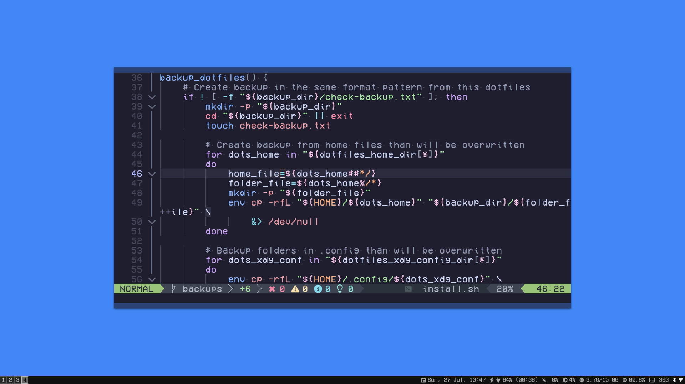

# Dotfiles

## Here are my dotfiles. That's it.



<p align="center">
    <b>Screenshots</b><br>
    <a href="images/rofi.png">Rofi</a>&nbsp;&nbsp;&nbsp;
    <a href="images/thunar.png">Thunar</a>&nbsp;&nbsp;&nbsp;
    <a href="images/tmux.png">Tmux</a>
</p>

## About this repository

While I'd love to try to make this work out of the box, that's not my main goal. I see this repository as a project to play around with Linux a bit and get a better understanding of the system. Feel free to use anything available here, and if you encounter any issues, feedback is welcome.

## Dependencies

I use Artix Linux with OpenRC, and i normally use these dotfiles on top of a fresh install. Below are the main programs I use and how I downloaded them:

| Item           | Source |
|----------------|--------|
| alacritty      | Cargo  |
| brightnessctl  | Pacman |
| dunst          | Pacman |
| fastfetch      | Pacman |
| fd-find        | Cargo  |
| feh            | Pacman |
| fzf            | Pacman |
| git            | Pacman |
| gtk3           | Pacman |
| i3-wm          | Pacman |
| i3blocks       | Pacman |
| inotify-tools  | Pacman |
| maim           | Pacman |
| picom          | Pacman |
| pipewire       | Pacman |
| pipewire-pulse | Pacman |
| polybar        | Pacman |
| rofi           | Pacman |
| starship       | Cargo  |
| sysstat        | Pacman |
| thunar         | Pacman |
| tmux           | Pacman |
| wireplumber    | Pacman |
| xclip          | Pacman |
| xcolor         | Cargo  |
| xorg-setxkbmap | Pacman |
| xorg-xset      | Pacman |

PipeWire handles the audio, and `pipewire-pulse` lets the volume scripts keep using `pactl`. The power menu uses `loginctl` for logout, suspend, reboot, and shutdown, with elogind and polkit handling authorization. I don't currently hibernation.

In addition, there are dependencies for GTK and for a font. They are

    - `Catppuccin-Mocha-Standard-Sky-Dark` theme for GTK.
    - `Material-Black-Blueberry-Numix-FLAT` icon theme for GTK.
    - `Bibata-Modern-Classic` cursor theme for GTK.
    - `VCROSDMono` font. A patched version of the VCROSD font.

All of these are inside the `resources` folder.

## Download and installation

The bootstrap scripts are in `scripts/bootstrap`:

- **scripts/bootstrap/download.sh** installs the necessary dependencies with Pacman and Cargo, like fzf and alacritty. It only runs on Artix Linux with OpenRC.
- **scripts/bootstrap/install.sh** simply creates the symlinks that point to the files inside the repository where the system expects to find the files, and decompress the resources in the correct folders. It also creates a simple backup of your current configuration, and allows you to restore it if something goes wrong.
- **scripts/verify_dependencies.sh** checks whether the commands used by the scripts, i3, and Polybar are available.

This process can be automated with:

```bash
cd
sudo pacman -Syu --needed git
git clone https://github.com/alquimas/dotfiles .dotfiles && cd .dotfiles
chmod +x scripts/bootstrap/download.sh
./scripts/bootstrap/download.sh
chmod +x scripts/bootstrap/install.sh
./scripts/bootstrap/install.sh -i
./scripts/verify_dependencies.sh
```

To use PipeWire, enable its OpenRC user services (without sudo):

```bash
rc-update -U add dbus default
rc-update -U add pipewire default
rc-update -U add pipewire-pulse default
rc-update -U add wireplumber default
```

Then reboot the system.
